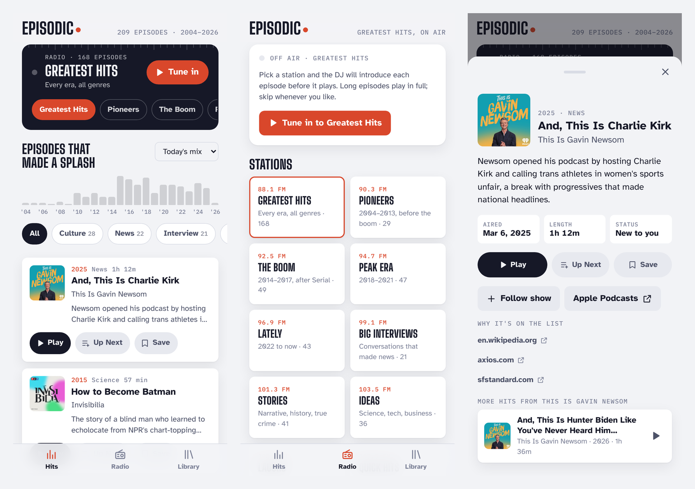

# Episodic

A podcast app built around individual episodes instead of shows. It opens on 209 episodes that made a splash between 2004 and 2026, and has a greatest-hits radio where a DJ introduces each episode before it plays.

<picture>
  <source media="(prefers-color-scheme: dark)" srcset="docs/screenshots-dark.png">
  
</picture>

It's a single static page with no build step and no backend. Your library lives in the browser on each device.

## Features

- **Hits.** Every episode in the catalog, in a fresh mix each day. Filter by year from the bar chart or by genre, or sort newest/oldest first. Each episode has **Play**, **Up Next** and **Save**.
- **Radio.** 16 stations:
  - 10 built from eras and genres, including Quick Hits for episodes of half an hour or less.
  - 6 hand-curated stations, such as Cons & Cover-ups and The Campaign Trail, each with written DJ intros.

  The device's built-in voice reads each intro before the episode starts. Intros can be turned off on the Radio tab.
- **Library.** Up Next (plays in order and empties as you go), Saved, followed Shows and History, plus a backup/restore so you can move your library to another device.
- **Make a station (optional).** Paste an Anthropic API key into **Library → Settings** and describe a station in your own words, for example "long drive, scams and con artists". Claude picks episodes from the catalog and writes the DJ intros. The key is stored only on that device and sent only to Anthropic.
- **Installable.** Add it to your home screen and it runs full screen with lock-screen controls. The app shell works offline; audio streams from each show's feed.

## Project layout

```
app/      the whole app: index.html, catalog.json, service worker, manifest, icons
tools/    scripts and research data that build app/catalog.json
docs/     README screenshots
```

## Run it locally

```
cd app
python3 -m http.server 8000
```

Then open http://localhost:8000. (Opening `index.html` straight from disk won't work, because the catalog is loaded with `fetch`.)

## Deploy to GitHub Pages

The repo includes a workflow (`.github/workflows/pages.yml`) that publishes the `app/` folder.

1. Push the repo to GitHub.
2. Go to **Settings → Pages**. Under "Build and deployment", set Source to **GitHub Actions**.
3. Push to `main`, or run the workflow from the **Actions** tab. The site appears at `https://<your-username>.github.io/<repo-name>/`.

Pages on a private repo needs a paid plan. Any other static host works too; upload the contents of `app/`.

## Put it on your phone

- **iPhone:** open the site in Safari, tap Share, then **Add to Home Screen**.
- **Android:** open it in Chrome and choose **Add to Home screen** or **Install app**.

## Rebuilding the catalog

With Python 3 (standard library only):

```
python3 tools/resolve.py   # matches each episode in tools/data/era_*.json to its show feed and audio
python3 tools/build.py     # writes app/catalog.json, applying tools/data/overrides.json and stations.json
```

To add an episode, append it to one of the `tools/data/era_*.json` files with its show, title, year, genre, a one-line reason and a source link, then run both scripts.

## Known limits

- **Catalog coverage:** 168 of the 209 episodes play. The rest are paywalled or no longer in their show's free feed (old Hardcore History, early WTF, older Daily and Ezra Klein episodes, and Mike Daisey's retracted episode). They're hidden by default; a link under the list shows them.
- **DJ intros while locked:** intros are skipped while the screen is locked, because phones won't speak in the background. The episode still plays.
- **Broken audio links:** a show can move or remove an episode at any time. If one won't load, Radio and Up Next skip ahead automatically.
- **BBC episodes:** these redirect through a plain-http server and may not play on every phone.
